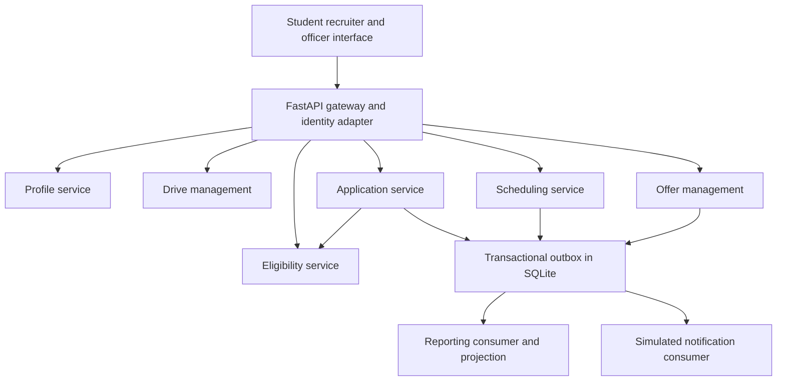

# Architecture and Report Alignment

## Deployment model

The gateway is a single FastAPI application. Each business capability has its own router/module and an input contract. Services collaborate through Python calls inside this process; browser clients use real HTTP APIs. SQLite is the local persistence and outbox transport. A separate optional worker process can consume the same outbox.

Logical ownership is represented by service modules and documented table responsibilities; shared SQLite transactions do not provide physical data-store isolation. This is the modular-monolith implementation stage recommended in report Section 2.6, not independently deployed network services.

## Ownership

| Logical owner | Owned records | Main API |
| --- | --- | --- |
| Profile | profiles, resume metadata and files | `/v1/students/me`, `/v1/resumes` |
| Drive Management | drives and published policy version | `/v1/drives` |
| Eligibility | Deterministic evaluation result | `/v1/eligibility/evaluations` |
| Application | applications, saved decision snapshot and idempotency record | `/v1/drives/{id}/applications` |
| Scheduling | interview reservations | `/v1/interviews` |
| Offer Management | offer states and exclusive acceptance | `/v1/offers` |
| Notification | inbox entries and consumer receipts | `/v1/notifications` |
| Reporting | application/offer projections | `/v1/reports/placements` |

The identity adapter owns local users and sessions. Outbox, audit and settings are shared local infrastructure. The initial cohort is 2027, and all records created through the demo UI remain within this cohort.

## Transaction and failure behaviour

Each write opens a separate connection and begins an immediate transaction. Eligibility rechecks, application creation, idempotency registration, outbox insertion and audit insertion therefore commit together in the local deployment. Profile and drive updates cannot interleave with that decision. This deliberately simplifies the report's distributed admission context.

CGPA values are stored as integer hundredths and validated as decimals with two places. The inclusive rule compares these integers. Verification is checked before a final academic decision; accepted offers and closed/expired drives also block participation.

Applications have a unique `(student_id, drive_id)` key. Retry keys are scoped to a principal and bound to a request digest including the drive and resume version. Exact retries return the original application; key reuse with different content returns 409. Old snapshots remain immutable when academic versions change.

Interview conflict checks compare half-open intervals and include the student, room and interviewer. Write serialization prevents a second request from passing on a stale calendar. Names are case-insensitive; all stored times are normalized to UTC.

Offers require SELECTED applications. Decisions enforce actor scope, expected version, allowed state and expiry. A partial unique index additionally protects one ACCEPTED offer per student. Revoking an acceptance releases that invariant while retaining audit evidence. This demo does not automatically withdraw other existing applications when an offer is accepted.

The worker reads pending outbox rows in commit order. Each consumer records `(event_id, consumer)` once. A notification outage does not block reporting. After three dispatch attempts with a failed consumer, the event becomes DEAD. Replay resets attempts but preserves consumer receipts. A worker crash before commit rolls back that batch; a repeat cannot duplicate completed effects. The in-app notification provider uses the same database transaction, so this demonstrates outbox semantics without claiming network exactly-once delivery.

## Functional alignment

| Report requirement | Implemented evidence | Boundary |
| --- | --- | --- |
| FR1 verified profiles | Officer revisions, version conflicts, immutable submission snapshots | Manual verification replaces ERP import |
| FR2 approve drives | Recruiter draft, officer publish/close, student draft hiding | Seeded approved companies; no employer onboarding workflow |
| FR3 eligibility | Reusable endpoint, reason codes, decimal thresholds | Fixed supported rule fields; no arbitrary rule language |
| FR4 durable submissions | Unique constraints, scoped idempotency and outbox | Shared local transaction instead of distributed admission |
| FR5 scheduling | Resource overlap checks, cancellation and concurrent tests | No external calendar integration or travel-buffer policy |
| FR6 offers | States, actor checks, deadlines and exclusive acceptance | No real offer document signing |
| FR7 notification | Pending/dead/delivered, outage injection and safe replay | In-app simulated provider instead of email/SMS |
| FR8 reporting | Event projection, cohort definitions, reconciliation and CSV | Current retained 2027 cohort; no arbitrary reporting window |

## Qualification limits

The implementation demonstrates the core academic workflows. It does not qualify the report's availability, p95 latency, 200-session capacity, RPO/RTO or accessibility targets. Tests cover specific local scenarios, not exhaustive security or performance assurance. OIDC, ERP, production hosting, malware scanning, independent service databases and distributed compensation remain future work.

## Technical references

- [FastAPI multi-file applications](https://fastapi.tiangolo.com/tutorial/bigger-applications/)
- [FastAPI testing](https://fastapi.tiangolo.com/tutorial/testing/)
- [Python sqlite3 reference](https://docs.python.org/3.12/library/sqlite3.html)

Consult the supplied SOA case study for the broader architectural references. These documents explain tools and patterns; they are not evidence of a real university deployment.
